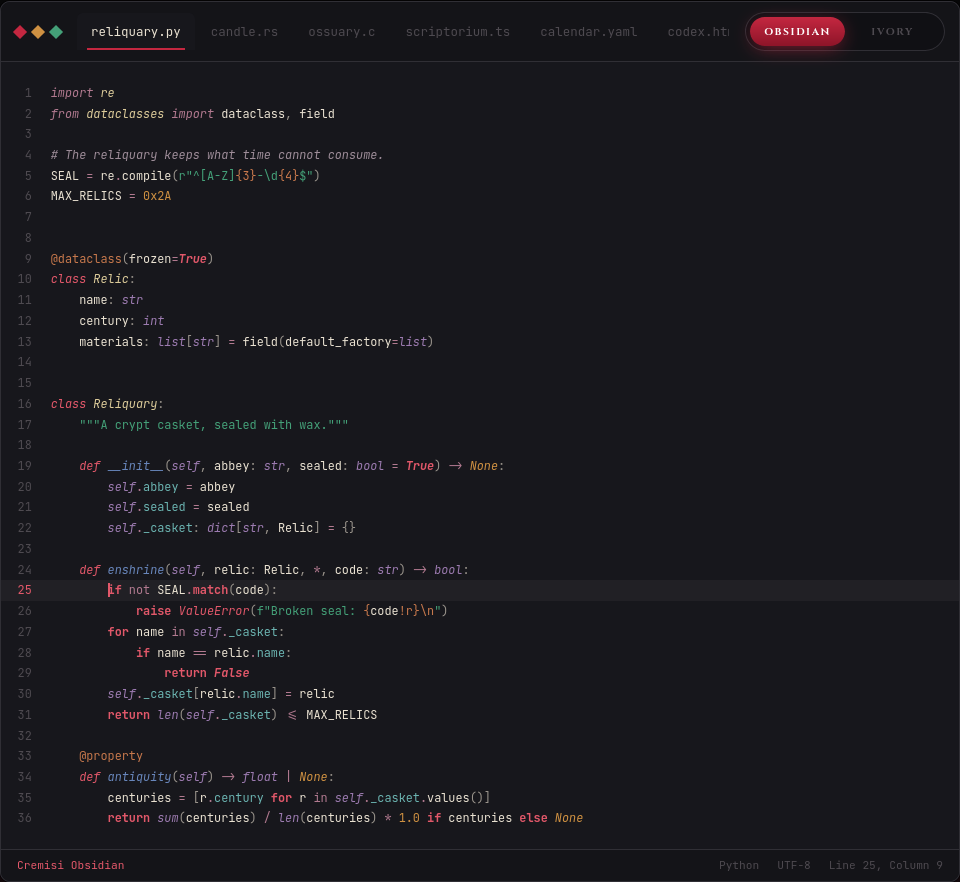
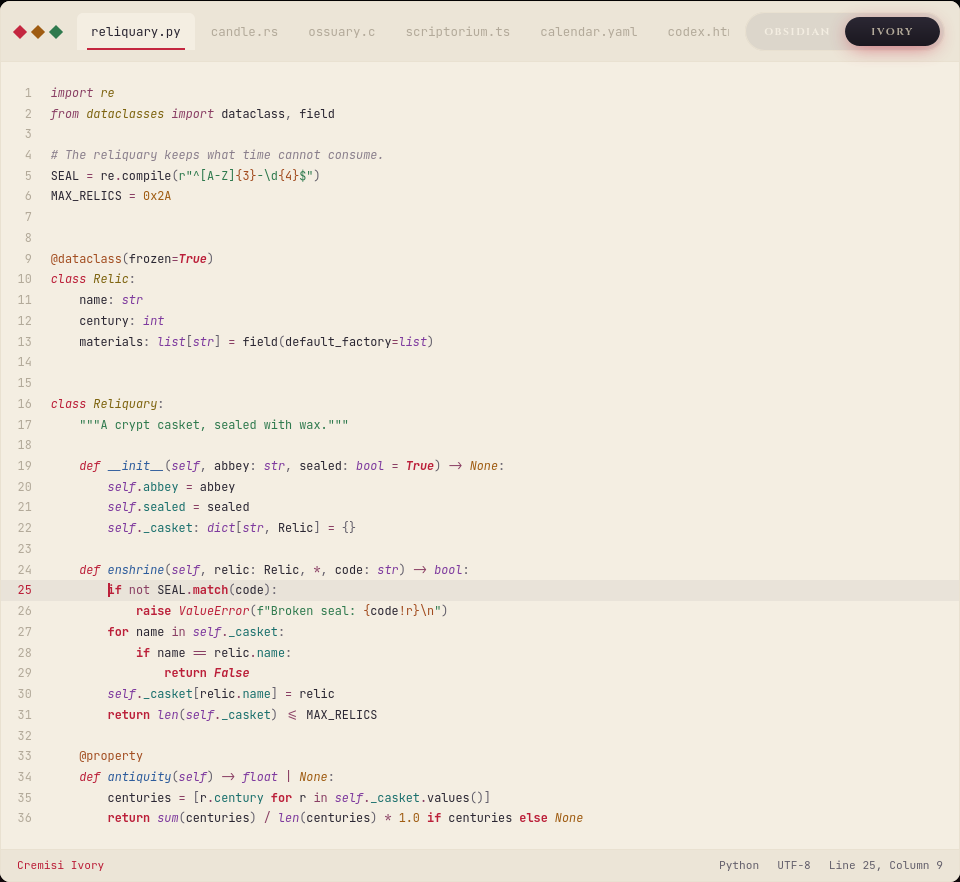

<div align="center">

# Cremisi

*Ex umbra in lucem*

A gothic, arcane colour scheme in two variants, **Obsidian** and **Ivory**,
for Sublime Text, VS Code, Hugo (Chroma) and the fish shell.
Every colour is born from an object: blood, bone, stone, amber, verdigris.

**[vari-sh.github.io/cremisi](https://vari-sh.github.io/cremisi/)**

For VS Code: **[Cremisi on the Visual Studio Marketplace](https://marketplace.visualstudio.com/items?itemName=vari-sh.cremisi-theme)**

</div>

<p align="center">
  
  
</p>

## Concept

Cremisi is a cabinet of materials: every hue comes from a real substance, desaturated, earthy and mineral.
**Blood** is the protagonist, **bone** is the text, **stone** is the ground; everything else revolves around them.

- **Crypt stone.** The dark ground is cold slate, the stone of a crypt; Ivory is the same stone read from its lightest end.
- **Crimson rules.** Keywords, control flow, booleans, null and accents all speak with the voice of blood. Crimson `#c42740` is the only colour shared by both variants.
- **Two cold notes.** Lapis blue for functions and keys, verdigris for properties. Every other hue is warm or mineral.
- **Legible by rule.** Every code token clears WCAG AA (4.5:1) against its own background. Only comments, the smoke of incense, may fall below.

## Palette

The same sixteen names in both variants: only the values change.
Contrast is measured against each variant's ground; `*` marks comments, exempt from the rule.

| Material | Key | Obsidian | Ivory | Role | Contrast O / I |
|---|---|---|---|---|---|
| Crypt stone | `ground` | `#17171c` | `#f4eee2` | Background |  |
| Bone / ink | `ink` | `#e9e1d1` | `#2b2733` | Text, variables | 13.74 / 12.61 |
| Wrought iron | `iron` | `#9a948c` | `#64606c` | Punctuation | 5.94 / 5.30 |
| Incense | `incense` | `#9e8d99` | `#8a7f8c` | Comments, docstrings | 5.72 / 3.31 * |
| Crimson | `crimson` | `#c42740` | `#c42740` | Accent, caret, selection |  |
| Crimson deep | `crimson_deep` | `#7e1023` | `#7e1023` | Selection border |  |
| Blood | `blood` | `#e2586a` | `#bb1f39` | Keywords, control flow, booleans and null, tags, exceptions | 4.97 / 5.40 |
| Lapis | `lapis` | `#6886bb` | `#2d5c9c` | Functions, JSON and YAML keys | 4.86 / 5.82 |
| Tallow | `tallow` | `#dccb9a` | `#7e6410` | Types, classes, namespaces, attributes | 11.10 / 4.89 |
| Amber | `amber` | `#cf9142` | `#9f5c12` | Numbers, constants | 6.62 / 4.53 |
| Sealing wax | `sealwax` | `#c6784c` | `#a24d20` | Decorators, annotations, escapes, placeholders, regex | 5.27 / 5.02 |
| Malachite | `malachite` | `#44a078` | `#2f7a4e` | Strings | 5.57 / 4.53 |
| Verdigris | `verdigris` | `#6bb3b0` | `#1a706d` | Properties, members | 7.40 / 5.07 |
| Amethyst | `amethyst` | `#9c7bb0` | `#7e3a9e` | Builtins, self, YAML anchors | 5.00 / 6.09 |
| Wine | `wine` | `#b27a90` | `#8a3f64` | Operators, imports, key-value colons | 5.17 / 6.11 |
| Withered petal | `petal` | `#c58f96` | `#a8465f` | Parameters | 6.59 / 4.90 |

Interface variables: `border` `#302f35` / `#e9e1d1`, `gutter_fg` `#4e4a50` / `#b3aa9a`.

### Four voices

The shape of the letter tells you the role before the colour does.

| Style | Roles |
|---|---|
| *Italic* | comments, keywords and declarations, imports, functions, types and classes, parameters, attributes, builtins and `self`, JSON and YAML values, exceptions |
| **Bold** | control flow: `if`, `for`, `while`, `return` |
| ***Bold italic*** | booleans and null |
| Regular | strings, numbers, operators, punctuation, variables, keys, properties |

## Ports

| Port | Files | |
|---|---|---|
| [Sublime Text](ports/sublime) | `Cremisi Obsidian.sublime-color-scheme`, `Cremisi Ivory.sublime-color-scheme` | [install](ports/sublime#install) |
| [Hugo (Chroma)](ports/hugo) | `cremisi-syntax.css` | [install](ports/hugo#install) |
| [VS Code](ports/vscode) | `Cremisi Obsidian`, `Cremisi Ivory` (extension) | [Marketplace](https://marketplace.visualstudio.com/items?itemName=vari-sh.cremisi-theme) · [install](ports/vscode#install) |
| [fish](ports/fish) | `cremisi-obsidian.theme`, `cremisi-ivory.theme` | [install](ports/fish#install) |
| [CSS scales](ports/css) | `cremisi-scales.css` | [usage](ports/css#usage) |

## Two scales

Eleven steps of **stone** and eleven of **blood**, interpolated in OKLCH, for building interfaces on top of Cremisi.
Structure and identity, and nothing else, on purpose: syntax highlighting stays with the materials.
They ship as custom properties in [`ports/css/cremisi-scales.css`](ports/css/cremisi-scales.css) (`--cremisi-stone-*`, `--cremisi-blood-*`).

| Step | Stone | | Blood | |
|---|---|---|---|---|
| 50 | `#f4eee2` | = Ivory ground | `#feeff0` |  |
| 100 | `#e9e1d1` | = Obsidian ink, Ivory border | `#ffddde` |  |
| 200 | `#cfc6b8` |  | `#febec1` |  |
| 300 | `#b3aa9a` | = Ivory gutter | `#fa969f` |  |
| 400 | `#9a948c` | = Obsidian iron | `#ef6f80` |  |
| 500 | `#827a76` |  | `#e2586a` | = blood |
| 600 | `#696164` |  | `#c42740` | = crimson |
| 700 | `#4e4a50` | = Obsidian gutter | `#a11730` |  |
| 800 | `#302f35` | = Obsidian border | `#7e1023` | = crimson deep |
| 900 | `#17171c` | = Obsidian ground | `#52151f` |  |
| 950 | `#0c0c10` |  | `#301419` |  |

Stone is not a neutral grey: its hue slides from warm bone (about 85°) to the violet stone of the crypt (about 285°),
crossing a faintly rosy grey on the way. Blood 400–800 are the reds of the theme; 50–300 open toward the petal,
for badges and alerts on Ivory, 900–950 thicken into clotted blood, for error and diff grounds on Obsidian.
`scale_ui` in [`palette.yaml`](palette.yaml) is a role-by-role recipe for an interface built only from the scales.

## Repository

```
palette.yaml   the palette: materials, interface variables, Sublime globals and rules, scales
ports/         one folder per port, each with its own README
assets/        previews
```

Every port is generated from `palette.yaml`; the live page at [vari-sh.github.io/cremisi](https://vari-sh.github.io/cremisi/) is built from the same data.

## License

[MIT](LICENSE) © vari.sh
